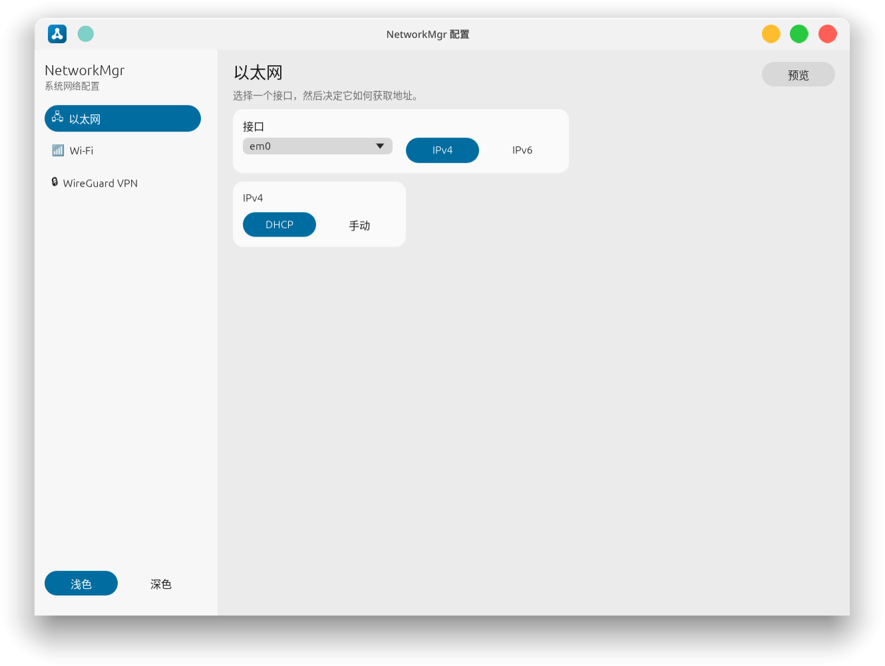
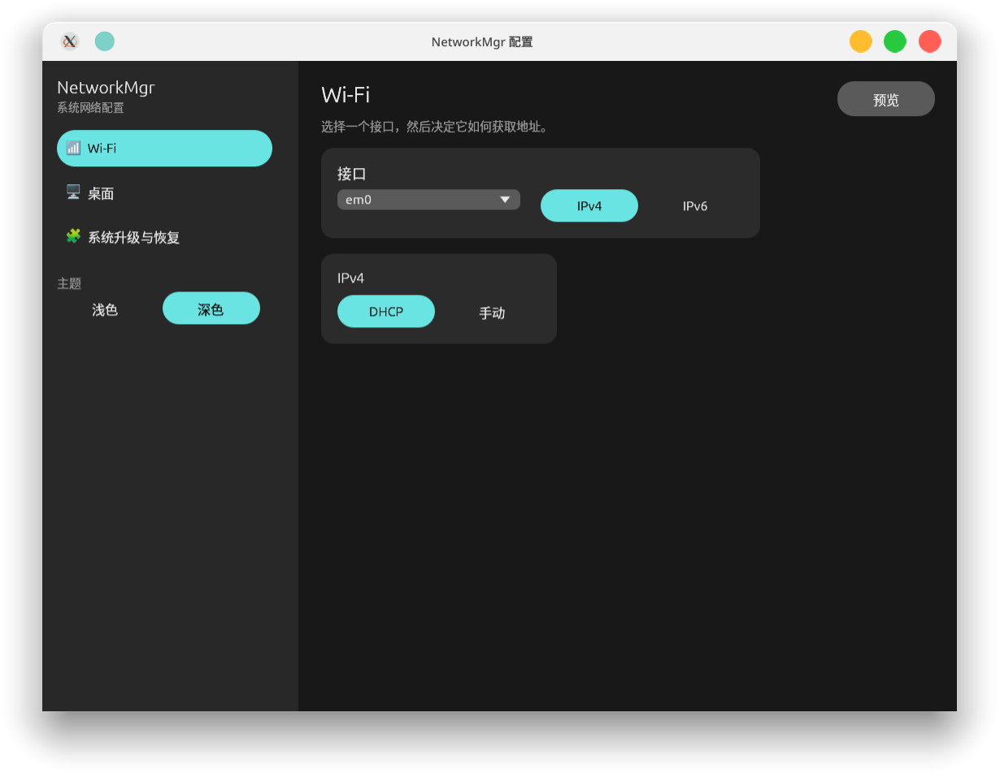
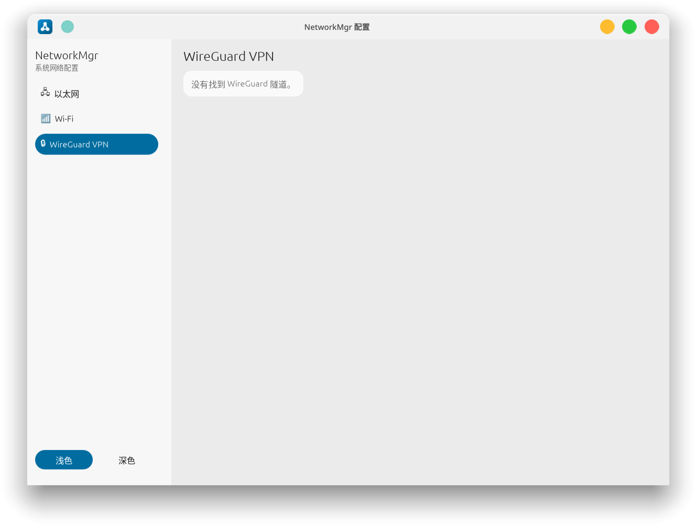

# NetworkMgr（Rust 重写）

用 Rust + egui / eframe 重写 NetworkMgr，目标平台仍是 FreeBSD / GhostBSD / DragonFlyBSD，
并尽量保持原项目的外部契约：安装路径、sudoers、devd 事件、`rc.conf`、
`wpa_supplicant.conf`、XDG 自启动与 gettext 翻译。

> **0.2.1 预览版已发布**：GitHub Releases 提供 FreeBSD 15 的 **amd64** `.pkg`
> （见 [Releases](https://github.com/wenyinos/networkmgr/releases)；aarch64 在 arm64
> runner 上构建超时，暂未发布，需要时用 `workflow_dispatch` 的 `arch=aarch64` 单独补）。
> 包名 **`networkmgr-rust`**，可与官方 Python 版 `networkmgr` 同时安装；
> 尚未进入 FreeBSD port。

## 安装（0.2.1）

```sh
sudo pkg add ./networkmgr-rust-0.2.1-amd64.pkg
# 或
sudo pkg install -y ./networkmgr-rust-0.2.1-amd64.pkg
```

安装后从应用菜单启动「NetworkMgr (Rust)」，或运行 `sudo networkmgr-rust`。
卸载用 `sudo pkg delete -y networkmgr-rust`。发布说明见
[`docs/RELEASE-0.2.1.md`](docs/RELEASE-0.2.1.md)。

与 Python 版共存：二进制是 `networkmgr-rust` / `networkmgr_configuration-rust`，
desktop 放在 `share/applications`（不写 autostart），sudoers 与 devd 规则用独立文件，
gettext domain 是 `NetworkMgr-rust`。要接管 devd 事件时，把
`/usr/local/etc/devd/networkmgr-rust.conf.sample` 复制为 `.conf`，并停用 Python 版规则。

## 仓库内容

| 路径 | 说明 |
|---|---|
| [`docs/RUST_REWRITE_PLAN.md`](docs/RUST_REWRITE_PLAN.md) | 完整方案：外部契约冻结、四阶段迁移、A/B/C 验收矩阵、风险登记、ADR、实测记录 |
| [`rust/`](rust/) | 零依赖 `networkmgr-core`：**104 个契约测试**，覆盖配置校验、`wpa_cli` 输出解析、`ifconfig` / `netstat` / `sysrc` 解析、`rc.conf` / `resolv.conf` 安全写入、WireGuard、托盘状态聚合、MO 翻译目录、devd 事件处理、命令执行层；含 `dump-state`、`apply-config`、`networkmgr-devd` 三个二进制 |
| [`rust/spikes/`](rust/spikes/) | 四个 GUI 程序（12 个测试）：eframe/glow 最小窗口、tray-icon 原生菜单托盘、配置窗口（COSMIC 风格，明暗双主题 + IPv4/IPv6 校验预览）、托盘主程序（动态子菜单、30 秒刷新、扫描连接与 Forget、gettext 菜单） |
| [`.github/workflows/freebsd-rust.yml`](.github/workflows/freebsd-rust.yml) | 远端 FreeBSD 15.1 构建：core 测试 + 全部 GUI 程序，产出七个 FreeBSD 二进制 |
| [`.github/workflows/release.yml`](.github/workflows/release.yml) | tag 或手动触发：构建 `.pkg` 并创建 GitHub Release；`arch` 可选 `both`/`amd64`/`aarch64`，aarch64 失败不再拖住 amd64 发布 |
| [`rust/spikes/deploy-to-vm.sh`](rust/spikes/deploy-to-vm.sh) | 把 CI 产物拷进 `freebsd15` VM 实跑验收 |
| [`docs/execution-report-2026-11-07.md`](docs/execution-report-2026-11-07.md) | 分轮实施记录：做了什么、验证到什么程度、哪些没做 |

## 界面预览

配置窗口（阶段 2）已按 COSMIC / iced 视觉重做，左侧三个页签分别是有线、无线与 VPN，
明暗切换固定在左下角：

| 以太网（浅色） | Wi-Fi（深色） |
|---|---|
|  |  |

| WireGuard VPN（浅色） |
|---|
|  |

> 有线与无线共用地址配置表单；只有无线页显示 Wi-Fi 凭据卡片。窗口固定 800×640，
> 内容超出时滚动，不裁切字段。
> 截图来自本机实跑（`LANG=zh_CN.UTF-8`，`NETWORKMGR_PAGE=wire|wireless|vpn`），
> 不是设计稿；默认 dry-run，只有 `--apply` 才会写入 `rc.conf`、`resolv.conf` 与 wpa 网络块。

托盘菜单已接入 gettext，按 `LANG` 自动选择现有 7 种翻译。下面是 FreeBSD 15 VM 上
`LANG=zh_CN.UTF-8` 的实拍：


> 截图来自本机实跑（`LANG=zh_CN.UTF-8`，`NETWORKMGR_THEME=light|dark`），不是设计稿。
> 默认 dry-run，只有 `--apply` 才会写入 `rc.conf` 与 `resolv.conf`。
> 7 种现有语言都已补齐配置窗口条目；`de_DE` 这类区域名会回退到基语言 `de`。
>
> 窗口左上角与桌面快捷方式使用同一套应用图标：`src/icons/scalable/apps/networkmgr.svg`
> 及其 13 个 hicolor 尺寸；配置窗口内嵌 64×64 RGBA，不依赖图像解码库。

## 本地开发

```sh
cd rust
cargo test                    # 纯逻辑层契约测试，Linux 宿主可直接跑
cargo fmt --check

cd spikes
cargo fmt --check
cargo test --no-default-features --features sni   # A 类环境无 GTK 开发库时用 SNI 后端
cargo build --release --locked --bins             # 默认 appindicator 后端，需 GTK3
```

GUI 程序都支持 `SPIKE_SECONDS=<秒>` 自动退出，便于无人值守验收；
配置窗口另可用 `NETWORKMGR_THEME=dark` 启动即暗色。
托盘后端用 feature 切换：`appindicator`（默认，需 GTK 主循环）或 `sni`（自带 D-Bus worker）。

## 远端构建与 VM 验收

本机不能交叉编译 FreeBSD；二进制由远端 CI 产出，或在 FreeBSD VM 内直接编译：

```sh
gh run download <run-id> -n networkmgr-freebsd15-spikes -D ./artifacts
virsh -c qemu:///system net-dhcp-leases default      # 取 VM 当前 DHCP 地址，不要硬编码
./rust/spikes/deploy-to-vm.sh zemin@<vm-ip> ./artifacts
```

VM 内已装 `rust` 与 GTK3 时也可以直接构建：

```sh
cd rust/spikes && cargo build --release --locked
cd .. && cargo build --release --locked --bin networkmgr-devd
```

翻译验证：`msgfmt po/zh_CN.po -o /tmp/zh_CN.mo` 后设置
`LANG=zh_CN.UTF-8 NETWORKMGR_MO=/tmp/zh_CN.mo` 启动托盘或窗口。

## 验收边界

- **A｜本机 Fedora**：纯逻辑层契约测试、格式检查、GUI spike 编译与起窗预验证。
- **B｜FreeBSD 15 VM**：CI 产物在 Xfce 下的窗口与托盘实跑**已通过**（方案第 20 节）；有线网络、静态 IP、devd 链路仍待验收，VM 无无线网卡。
- **C｜实体机 / GhostBSD**：真实 Wi-Fi 扫描与连接、企业级 EAP、桌面集成与打包验收。

VM 绿灯不等于验收完成；阶段 3 结束必须同时有 B 与 C 的记录。详见方案第 13 节。

## 已知限制

- **0.1.0 的 pkg 缺 `libayatana-appindicator` 运行依赖**（干净系统上启动即 panic，退出码 101），
  **0.2.0 起已修复**：`+MANIFEST` 显式声明依赖，程序启动前也会自检并给出可照做的提示。
- **用 root 跑过托盘后，普通用户可能起不来**（`Error: OsError(code 13)`）：
  root 会在 `$XDG_RUNTIME_DIR/tray-icon` 留下自己属主的缓存目录。**0.2.1 起**启动时
  会自动检查并清理；在此之前的手工办法是 `rm -rf "$XDG_RUNTIME_DIR/tray-icon"`。
  同版修复的还有 30–75 秒启动延迟、只认 Xfce 面板、root 父进程常驻，详见方案第 41 节。
- **阶段 0 / 1 已完成，阶段 2 主体完成，阶段 3 主体完成**：逻辑层全部移植并在 FreeBSD 上跑通 104 个测试，
  配置窗口能校验、预览并（`--apply`）真写；托盘支持扫描连接、密码框、Forget 与 gettext 菜单。
  仍有 300 ms 连接动画、企业级 EAP 凭据收集（引导至配置窗口）未实现。
- **本地化**：托盘与配置窗口的字符串都已走 `tr!`，7 个现有 `.po` 已补齐配置窗口与新增菜单项；
  未提供翻译的语言或条目按 gettext 规则回退英文，`de_DE` 这类区域名会回退到 `de`。
- **尚未进入 FreeBSD port**：以 GitHub Release 的 `.pkg` 发布；
  port 迁移仍需与 `net-mgmt/networkmgr` 维护者协调。
- 老机器的 `wpa_supplicant.conf` 可能缺 `ctrl_interface`，导致 `wpa_cli` 全链路不可用。
  配置窗口与托盘会检测并显示「修复控制接口」，等价于
  `apply-config --fix-wpa-ctrl`：备份后写入、chmod 0600，需手动重启 `wpa_supplicant` 生效。
- 真实无线关联受 FreeBSD 15 驱动限制：MT7601U 能扫描但关联超时，AR9271 已无
  `athn` 驱动；UI/状态层由模拟验证，**真实 EAP 认证仍需企业级 AP**。
- `service netif restart` 在 VM 上实测会让 SSH 掉线且不自动恢复（需重启机器），
  托盘里的 `Restart Networking` 已改为二次确认 + 只重启当前网卡。
